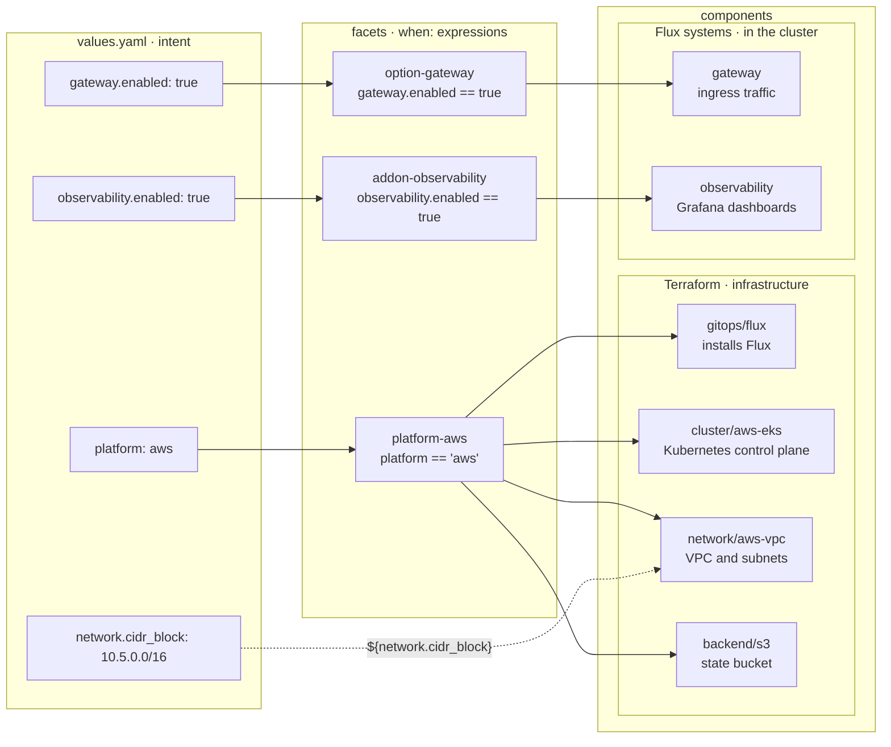

[Components](../components/terraform.md) walked you through how to reference Terraform modules and Kustomizations directly in a context's `blueprint.yaml`. That works as long as one context is all you have. A *blueprint* turns the same components into a template, shared by every context instead of hand-copied into each one.

Windsor reads a blueprint, fills in the values for the current context, and deploys the platform to your chosen target. Most projects start with the default [`core`](https://github.com/windsorcli/core) blueprint and build on top of that.

The examples on this page follow one project with two contexts. `local` runs on Docker on your workstation, and `production` runs on AWS. Both use `core`, and in this project everything that differs between the two clusters comes from a few lines in each context's `values.yaml`.

## What's in a blueprint

A blueprint is a directory named `_template/`. The `core` blueprint is the `contexts/_template/` directory of the `windsorcli/core` repository. This listing shows its layout.

```text
contexts/_template/
├── blueprint.yaml
├── schema.yaml
├── metadata.yaml
└── facets/
    ├── addon-observability.yaml
    ├── option-gateway.yaml
    ├── platform-aws.yaml
    ├── platform-docker.yaml
    └── ...
```

`blueprint.yaml` uses the same format as the `blueprint.yaml` you wrote in [Components](../components/terraform.md). This file is the basis that each context builds on. `schema.yaml` declares the settings a context can choose. `metadata.yaml` holds the blueprint's name and version and the oldest Windsor CLI version that can read it. The `facets/` directory holds the conditional parts of the template, allowing for variability from one context to the next.

Each context picks up the template through the `sources:` list in its own `blueprint.yaml`, where the entry `- name: template` stands for `contexts/_template/`. Anything else the context's file declares overrides the template for that context only, allowing different contexts to diverge while building on a common base. [The _template folder](templates.md) describes each file in detail.

## From values to components

`local` and `production` inherit from a common blueprint, yet `local` runs Talos in Docker containers while `production` runs an EKS cluster in a VPC. Something has to read each context's settings and choose the correct Terraform modules and cluster software suited for each environment.

### Values and schema

A context's settings are its *values*. You write them in `contexts/<name>/values.yaml`, and `windsor init` records a few on its own, such as the platform of a workstation context. For these two contexts the values that matter are the platform keys. `local` runs on Docker through Docker Desktop, so `init` sets its platform and workstation runtime.

```yaml
platform: docker
workstation:
  runtime: docker-desktop
```

`production` runs on AWS, and its `values.yaml` sets the platform and a region.

```yaml
platform: aws
aws:
  region: us-east-1
```

The blueprint's `schema.yaml` is a JSON Schema for these values. Windsor validates each context's values against it before performing any work. [Schema](schema.md) covers this file in more detail.

### Facets

The template cannot list `cluster/aws-eks` unconditionally, or `local` would try to build an EKS cluster too. A *facet* is a file in `facets/` whose components join the blueprint only when its `when:` condition is true for the current context. `core` has one facet per platform, such as `platform-aws`, and one per optional feature, such as `addon-observability`.

[`platform-aws.yaml`](https://github.com/windsorcli/core/blob/main/contexts/_template/facets/platform-aws.yaml), trimmed here to three of its entries, adds the AWS network, the EKS cluster, and one piece of the gateway.

```yaml
kind: Facet
apiVersion: blueprints.windsorcli.dev/v1alpha1
metadata:
  name: aws
when: platform == 'aws'
terraform:
  - name: network
    path: network/aws-vpc
    inputs:
      cidr_block: ${network.cidr_block}
  - name: cluster
    path: cluster/aws-eks
    dependsOn:
      - network
flux:
  - name: gateway
    when: "gateway.enabled == true && gateway.driver == 'envoy' && lb_effective.mode == 'loadbalancer'"
    resources:
      - name: external
        components:
          - envoy/loadbalancer/aws-nlb
```

For `production`, the top-level `when:` is true, so Windsor adds `network` and `cluster` to its blueprint. For `local` it is false, and other facets contribute the Docker-based components instead. A single entry can also carry its own `when:`, which narrows it further: the `gateway` entry adds the AWS load balancer only when the gateway runs Envoy behind a LoadBalancer Service.

Apart from what a context's own `blueprint.yaml` adds, every component a context gets comes from the template's `blueprint.yaml` or from a facet whose condition matched. [Facets](facets.md) covers how facets are ordered and how a facet computes values that later facets read.

### Expressions

A facet reads values twice: once to decide whether it applies, and again to pass settings into the components it adds. Both happen through *expressions*, written in [expr](https://expr-lang.org), a small expression language for Go. A `when:` condition is an expression, and so is the text inside each `${ }` substitution.

In the `network` entry of `platform-aws.yaml`, `${network.cidr_block}` reads `production`'s CIDR and passes it to the VPC module as its `cidr_block` input. The full file goes one step further for the cluster. There, `terraform_output('network', 'vpc_id')` reads the ID of the VPC that the `network` component created and passes it to `cluster/aws-eks`. Windsor adds `terraform_output()`, `cidrhost()`, and a few other functions to expr's standard set. The full set is listed at [Expressions](expressions.md).

### Terraform components and Flux systems

The components a facet adds come in two kinds. Terraform components build the infrastructure the cluster runs on, and Windsor applies them in `dependsOn` order. In `production` that order is `backend/s3` → `network/aws-vpc` → `cluster/aws-eks` → `gitops/flux`. In `local` it is `workstation/docker` → `compute/docker` → `pki/ca` → `cluster/talos` → `gitops/flux`. `gitops/flux` is the last terraform component applied before installing Flux kustomizations directly to the cluster.

Everything after Flux runs in the cluster as a *Flux system*, a named unit such as `gateway` or `observability` that Windsor compiles into Kustomizations. Most systems split into an install Kustomization for the controller and resources Kustomizations for what it manages, so `gateway` becomes `gateway-install` and `gateway-resources-external`.

Two facets can add to the same system. `option-gateway.yaml` declares `gateway` on every platform, `platform-aws.yaml` adds the NLB component to it, and Windsor merges the two entries because they share a name. [Flux systems](flux-systems.md) covers the install and resources tiers and the merge rules.

This diagram traces `production`, with observability turned on, from four of its values through their facets to the components they add.



### Composition

Windsor *composes* a context's blueprint by merging four layers in order: installed sources such as `core`, the project's own `template` source when the context lists one, the facets whose conditions matched, and the context's own `blueprint.yaml`. A later layer overrides an earlier one, which is how a `blueprint.yaml` in `contexts/production/` changes `production` without touching `local`.

`windsor show blueprint` prints the composed result. In `production`, its `cluster` component has the path `cluster/aws-eks`; in `local`, the same component has the path `cluster/talos`. To find out where one value came from, run `windsor explain terraform.network.inputs.cidr_block`, which traces the VPC's CIDR back through the facet expression to the schema default. [Composition workflow](../composition/workflow.md) covers the merge order, and [Inspecting](inspecting.md) covers the other inspection commands.

## One blueprint, many platforms

`local` and `production` are two rows of a larger table. Each `platform` value picks a module for each Terraform layer, and every platform still ends with `gitops/flux`, so the Flux systems install the same way on all of them.

| `platform` | Network                                | Compute           | Cluster             |
| ---------- | -------------------------------------- | ----------------- | ------------------- |
| `aws`      | `network/aws-vpc`                      | managed           | `cluster/aws-eks`   |
| `azure`    | `network/azure-vnet`                   | managed           | `cluster/azure-aks` |
| `gcp`      | `network/gcp-vpc`                      | managed           | `cluster/gcp-gke`   |
| `hetzner`  | `compute/hcloud`                       | `compute/hcloud`  | `cluster/talos`     |
| `vsphere`  | existing port group                    | `compute/vsphere` | `cluster/talos`     |
| `proxmox`  | existing bridge                        | `compute/proxmox` | `cluster/talos`     |
| `hyperv`   | `compute/hyperv`                       | `compute/hyperv`  | `cluster/talos`     |
| `incus`    | `compute/incus` or `workstation/incus` | `compute/incus`   | `cluster/talos`     |
| `docker`   | `workstation/docker`                   | `compute/docker`  | `cluster/talos`     |
| `metal`    | existing network                       | existing machines | `cluster/talos`     |

On AWS, Azure, and GCP the cluster module creates the node pools, so there is no compute module. Hetzner, Hyper-V, and Incus create their network in the compute module, except Incus on a workstation, where `workstation/incus` creates it.

The values pick cluster software too. `gateway` installs Envoy or Cilium depending on `gateway.driver`, and `csi` installs a storage driver that suits the platform.

## Sharing a blueprint

A template that works for every context in one project often fits other projects too. You can push a blueprint to an OCI registry, and a context in another project lists the artifact's URL in its `sources:` list the same way it lists `template`. `core` is published this way at `oci://ghcr.io/windsorcli/core:v0.8.0`, which is how a project builds on `core` without copying its `_template/` directory.

A context can list both a published blueprint and its own `template`. Sources merge in the order the context lists them, so `template` after `core` adds the project's own components on top of `core`'s. [Registries](sharing.md) covers publishing and consuming artifacts.

## Where to next

- [The _template folder](templates.md)
- [Schema](schema.md)
- [Facets](facets.md)
- [Expressions](expressions.md)
- [Flux systems](flux-systems.md)
- [Composition workflow](../composition/workflow.md)
- [Registries](sharing.md)
- [Testing](testing.md)
- [Inspecting](inspecting.md)
