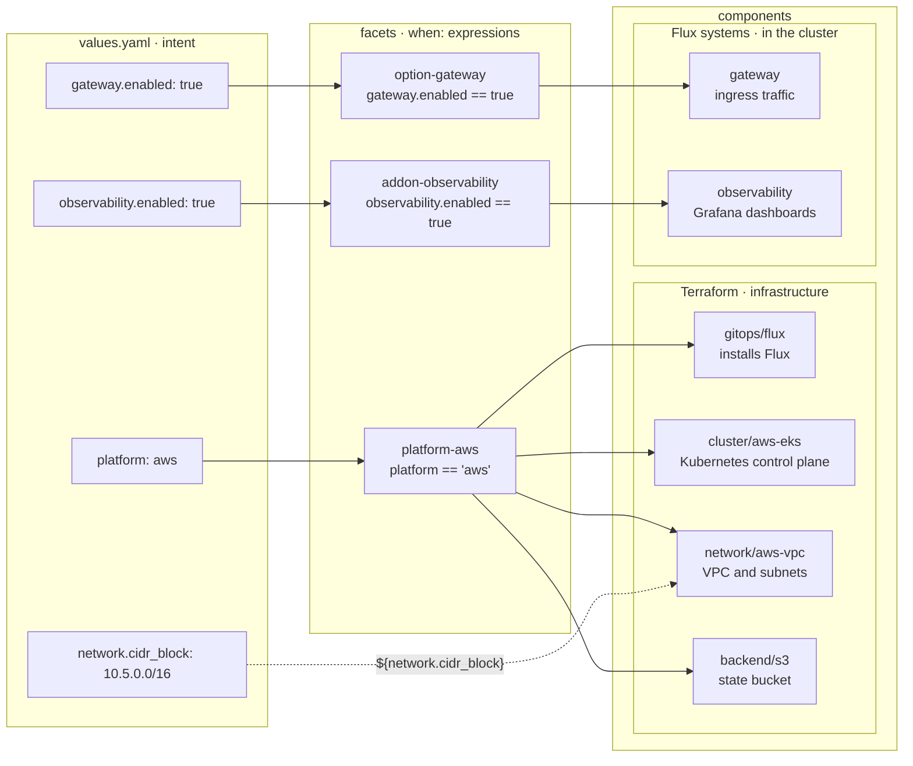

[Components](../components/terraform.md) puts Terraform modules and Kustomizations directly in one context's `blueprint.yaml`. That works as long as one context is all you have. A blueprint turns the same components into a template, shared by every context instead of hand-copied into each one. It lists:

- The Terraform components that provision infrastructure
- The Kustomizations that run on a Kubernetes cluster
- The configuration values the operator can set
- The conditional fragments (facets) that activate based on those values

Either section can be empty, so a blueprint can be a full Kubernetes platform or just a Terraform stack.

Windsor reads a blueprint, fills in the values for the current context, and deploys the platform to your chosen target. Most projects start with the default [`core`](https://github.com/windsorcli/core) blueprint and customize a few values.

A blueprint lives in `contexts/_template/`. The directory always contains a `blueprint.yaml` with the same `terraform:` and `kustomize:` entries as [Components](../components/terraform.md), written once and inherited by every context. The other files in `_template/` are optional.

| File | Purpose |
|---|---|
| `blueprint.yaml` | Terraform components and Kustomizations the platform installs |
| `schema.yaml` | JSON Schema for the configuration values the blueprint accepts |
| `metadata.yaml` | Name, version, and CLI version requirement |
| `facets/` | Conditional fragments activated by context values |

A blueprint can also be published as an OCI artifact and reused by other projects. The default `core` blueprint is published at `oci://ghcr.io/windsorcli/core:v0.8.0`.

Per-context customizations live in `contexts/<name>/`. Files there override or extend what `_template/` defines for that one context, so most contexts share their blueprint and differ only where they need to.

## From values to components

A context's `values.yaml` states intent: which platform, which add-ons, which drivers. Facets test those values with `when:` expressions, set on the whole facet or on a single component or system inside it, and every entry whose condition matches joins the composed blueprint. Expressions also carry values into component inputs, the way `${network.cidr_block}` reaches the AWS VPC module. The diagram follows part of the [`core`](https://github.com/windsorcli/core) blueprint for an AWS context.

Several facets can contribute to one system. On AWS with the Envoy driver, `platform-aws` adds an `envoy/loadbalancer/aws-nlb` component to the `gateway` system that `option-gateway` declares, and Windsor merges the two entries. Each Flux system compiles to Kustomizations such as `gateway-install` and `gateway-resources-external`, as described in [Flux systems](flux-systems.md).

Change `platform` and each layer resolves to a different module. Every platform ends with `gitops/flux`, so the Flux systems install the same way on each:

| `platform` | Network | Compute | Cluster |
|---|---|---|---|
| `aws` | `network/aws-vpc` | managed | `cluster/aws-eks` |
| `azure` | `network/azure-vnet` | managed | `cluster/azure-aks` |
| `gcp` | `network/gcp-vpc` | managed | `cluster/gcp-gke` |
| `hetzner` | `compute/hcloud` | `compute/hcloud` | `cluster/talos` |
| `vsphere` | existing port group | `compute/vsphere` | `cluster/talos` |
| `hyperv` | `compute/hyperv` | `compute/hyperv` | `cluster/talos` |
| `incus` | `compute/incus` or `workstation/incus` | `compute/incus` | `cluster/talos` |
| `docker` | `workstation/docker` | `compute/docker` | `cluster/talos` |
| `metal` | existing network | existing machines | `cluster/talos` |

On the three clouds, the cluster module creates managed node pools. Hetzner, Hyper-V, and Incus have no separate network module; their compute module creates the network along with the machines. On a workstation, Incus gets its network from `workstation/incus` instead.

The Flux systems swap the same way: `gateway` installs Envoy or Cilium depending on `gateway.driver`, and `csi` picks the storage driver for the platform. [Facets](facets.md) covers how facets match and merge, and [Expressions](expressions.md) covers the `${...}` language.

## Where to next

- [Directory layout](templates.md)
- [Schema dialect](schema.md)
- [Facets and conditional fragments](facets.md)
- [Flux systems](flux-systems.md)
- [Registries](sharing.md)
- [Testing](testing.md)
- [Inspecting](inspecting.md)
