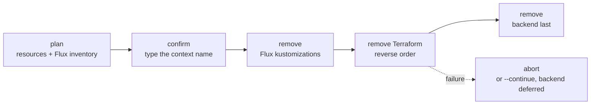

[`windsor destroy`](https://www.windsorcli.dev/reference/cli/commands/destroy) removes a context's live infrastructure. It removes the Flux kustomizations first, then every Terraform component in reverse-dependency order, and the backend last. Before it removes anything, it shows a plan and asks you to type the context name, or to pass `--confirm=<name>`.



## Tear down

On a local workstation, [`windsor down`](https://www.windsorcli.dev/reference/cli/commands/down) removes the local environment itself: the containers, volumes, and network on Docker, or the VM and its data on Colima. That is faster than the orderly Kubernetes teardown that `destroy` performs. When you want the orderly teardown, as you would on a production cluster, run `destroy` first and then `down`.

A cloud or metal context has no local environment, so `destroy` is the only command it takes. These commands show both cases.

```bash
windsor down                          # local workstation: fast
windsor destroy --confirm=staging     # cloud or metal: slow but orderly
```

## Safety and concurrency

Three behaviors guard a `destroy` run.

- If a Terraform resource carries `lifecycle { prevent_destroy = true }`, `destroy` warns up front that the run may halt partway through. It doesn't override the protection. To destroy the resource, remove the lifecycle block from its HCL.
- By default, `destroy` stops at the first component that fails. `--continue` keeps going, collects the failures, and prints a one-line summary at the end. It applies to a layer-wide destroy only, and Windsor refuses it with a component argument. If a Flux kustomization fails to delete, `destroy` skips Terraform. If a Terraform component outside the backend fails, it skips the backend, so the [state store](state-backend.md) stays in place for the components that still depend on it. Resolve the failures, then run `windsor destroy --continue` again, and the next pass picks up where the last one stopped.
- With a [Kubernetes backend](state-backend.md#kubernetes-backend), `destroy` copies all Terraform state back to your machine before it starts. If it fails partway through, run it again from the same machine.

[Locking](overview.md#locking) covers how Windsor keeps two commands from running against one context at the same time.

## See also

- [Overview](overview.md): where `destroy` fits among the other commands
- [State backend](state-backend.md): how the backend is created and why destroy removes it last
- [Upgrade](upgrade.md): moving a context forward instead of tearing it down
