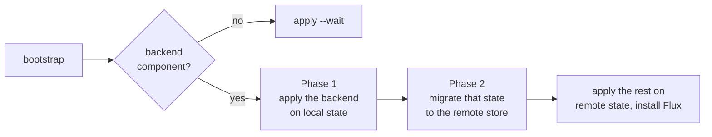
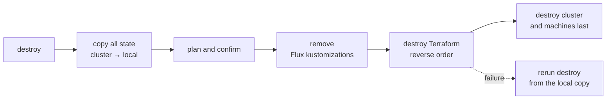

Every context keeps its Terraform state in a backend. Windsor picks a default for the platform, writes the backend settings for each component, and, on a first run, creates the remote store through a two-phase Terraform bootstrap.

## Choose a backend

When you do not set a backend, `--platform` picks a default, as this table shows.

| Platform                                                   | Default backend                                                            |
| ---------------------------------------------------------- | -------------------------------------------------------------------------- |
| `aws`                                                      | `s3`                                                                       |
| `azure`                                                    | `azurerm`                                                                  |
| `gcp`                                                      | `gcs`                                                                      |
| `metal`, `docker`, `incus`, `hetzner`, `hyperv`, `vsphere`, `proxmox` | `kubernetes` (state is stored as Secrets in the cluster; see [Kubernetes backend](#kubernetes-backend)) |
| `none`, unset                                              | not defaulted (effectively `local`)                                        |

To change it, set `terraform.backend.type` in `values.yaml` to `local`, `s3`, `azurerm`, `gcs`, or `kubernetes`. You can also pass `--backend` to `init` or `--set terraform.backend.type=...` to `bootstrap`.

If you don't specify a backend, Windsor creates one. To use a store that you've already created, see [Use an existing backend](#use-an-existing-backend).

State is keyed per component and isolated within a context. Windsor writes the backend settings into a generated `backend_override.tf` next to each module, so a module never needs a hard-coded `backend` block. The [Terraform page](../components/terraform.md#folder-layout) has more information.

## Use an existing backend

Describe the store in `values.yaml`, under `terraform.backend`. This `staging` context uses an S3 bucket and a DynamoDB lock table that already exist.

```yaml
# contexts/staging/values.yaml
terraform:
  backend:
    type: s3
    s3:
      bucket: my-existing-state
      region: us-east-2
      dynamodb_table: my-locks
```

Windsor passes these settings to `terraform init` as `-backend-config` arguments. This table lists what you set for each type and what Windsor sets.

| Type         | Set under `terraform.backend.<type>`                                     | Windsor sets    |
| ------------ | ------------------------------------------------------------------------ | --------------- |
| `s3`         | `bucket`, `region`, and `dynamodb_table` or `use_lockfile` for locking   | `key`           |
| `azurerm`    | `resource_group_name`, `storage_account_name`, `container_name`          | `key`           |
| `gcs`        | `bucket`                                                                 | `prefix`        |
| `kubernetes` | `namespace`, and `config_path` or `config_context` to choose the cluster | `secret_suffix` |

Azure, Google Cloud, and Kubernetes use similar blocks, one per type in these listings.

```yaml
terraform:
  backend:
    type: azurerm
    azurerm:
      resource_group_name: tfstate-rg
      storage_account_name: mytfstate
      container_name: tfstate
```

```yaml
terraform:
  backend:
    type: gcs
    gcs:
      bucket: my-existing-state
```

```yaml
terraform:
  backend:
    type: kubernetes
    kubernetes:
      namespace: tfstate
```

The full argument lists are in Terraform's documentation: [s3](https://developer.hashicorp.com/terraform/language/backend/s3), [azurerm](https://developer.hashicorp.com/terraform/language/backend/azurerm), [gcs](https://developer.hashicorp.com/terraform/language/backend/gcs), and [Kubernetes](https://developer.hashicorp.com/terraform/language/backend/kubernetes).

## Bootstrap

Windsor's bootstrapping flow handles the chicken-or-egg problem with Terraform state backends. It works in two phases. First it creates the backend resources with Terraform, then it switches every component to that backend.

1. Phase 1 sets `terraform.backend.type` to `local` in memory and applies the backend component and any component declared before it. This creates the remote state store, usually an object store.
2. Phase 2 restores the configured backend type and runs `terraform init -migrate-state -force-copy` for those components. This moves their state to the remote store.

The remaining components then initialize directly against the remote backend. The blueprint's `backend:` field decides which component is the backend component; see [The `backend` field](../blueprints/templates.md#the-backend-field).

When Windsor creates the default backend, it writes `contexts/<name>/backend.tfvars`. This file holds the store's connection settings, such as the bucket and region on AWS. Windsor passes the file to `terraform init` for every other component. Check the file in to source control.



These are typical `bootstrap` runs: for the current context, for another context, and for a new AWS context built from a blueprint.

```bash
windsor bootstrap                    # current context
windsor bootstrap staging            # switch context, then bootstrap
windsor bootstrap --platform aws --blueprint ghcr.io/org/blueprint:v1.2.0
```

## Kubernetes backend

On the Talos platforms, Windsor stores Terraform state in the cluster itself. Each component gets its own Secret in the `system-terraform` namespace, named after the component, such as `tfstate-default-cluster`. To use a different namespace, set `terraform.backend.kubernetes.namespace`.

Terraform's Kubernetes backend does not create the namespace. The `core` blueprint adds a `backend` component, `backend/kubernetes`, that creates it. The component runs right after `cluster` when `values.yaml` sets `terraform.backend.type: kubernetes`. `windsor init --platform` sets this value for the Talos platforms.

This is the same chicken-or-egg problem that [Bootstrap](#bootstrap) solves. The state needs the cluster, but Terraform builds the cluster. Windsor builds the cluster and the namespace using local state, then moves the state into the cluster once it's running.

Destroy works in reverse. Windsor copies all of the state back to your machine first, then tears everything down using that local copy. If a destroy fails partway through, run it again from the same machine. You can't destroy the `cluster` component by itself, since everything else's state lives on it.



If you lose the cluster, you lose its state too. Windsor keeps state there anyway because the cluster is the only store available without a cloud provider, and that works for many deployments, including production. If you can't afford to lose the state, use a cloud backend such as S3, Azure Storage, or GCS. See [Use an existing backend](#use-an-existing-backend).

### Change the state namespace

When the configured namespace differs from the one a component last used, `apply`, `up`, and `upgrade` move its state with `terraform init -migrate-state -force-copy` against the new namespace. Windsor prints one line for each component that it moves, such as this line for the cluster.

```text
Moved terraform state of cluster/talos from namespace default to system-terraform
```

Terraform copies the state and leaves the old Secrets in place. `plan` reads the state from the old namespace and writes nothing to the cluster. Older `core` releases kept state in `default`, so an upgrade moves it the same way.

> [!WARNING]
>
> Windsor reads the last-used namespace from `.windsor/`. A fresh checkout doesn't have it, so `up` can't find the old state and plans to recreate everything.

These commands copy the state Secrets from `default` to `system-terraform`. Run them before the first `up` from a fresh checkout.

```bash
kubectl create namespace system-terraform
kubectl get secret -n default -l tfstate=true -o json \
  | jq '.items |= map(.metadata = {name: .metadata.name, namespace: "system-terraform", labels: .metadata.labels})' \
  | kubectl apply -f -
```

## State locks

Windsor passes `-lock-timeout` to `init` and to every Terraform command that changes state. Set `terraform.lock.timeout` to change how long Terraform waits for a locked state. It defaults to `5m`, and this setting raises it to ten minutes.

```yaml
terraform:
  lock:
    timeout: 10m
```

Windsor also takes its own lock for each context, preventing two `windsor` commands on the same machine from running at the same time. That lock is separate and engages before Terraform's. See [Locking](overview.md#locking).

## See also

- [Overview](overview.md): the commands that read and write this state
- [Terraform](../components/terraform.md): declaring the components that use the backend
- [Destroy](destroy.md): how teardown treats the backend
