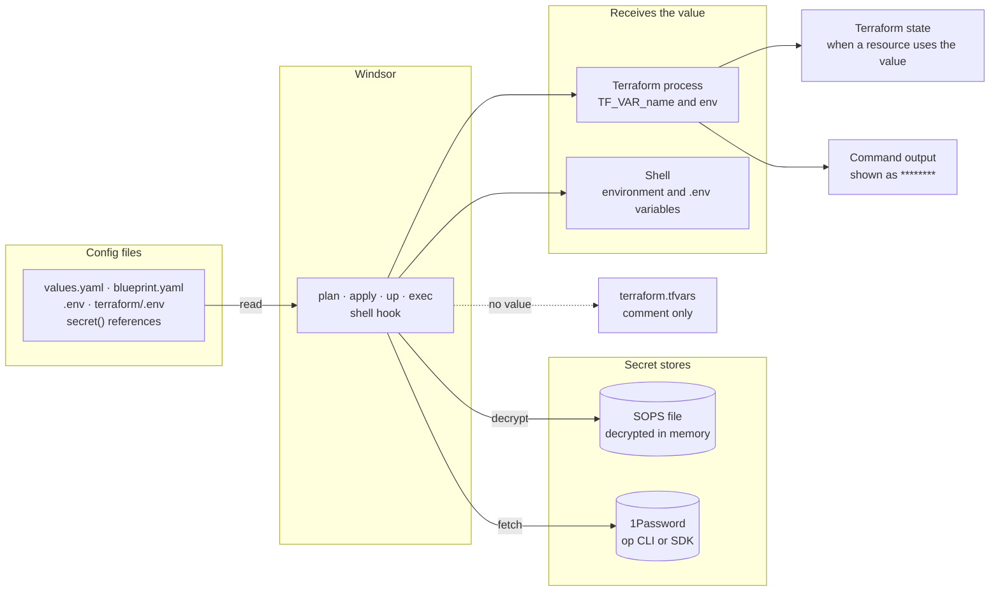

<!-- ai: rough draft. Structure only; the docs owner writes the final prose from the dossier. -->

A project's configuration lives in git, and so does everything in it. A Terraform provider token, a database password, or a cloud API key can't go into `values.yaml` or `blueprint.yaml` as plain text. Windsor keeps the value in a secret store and puts a *secret reference* in the file instead. A reference names where the value lives. Windsor resolves it only when a command needs the value, and it never writes the value back to a file.

Windsor reads secrets from two providers. [SOPS](sops.md) decrypts files that you commit next to the context. [1Password](1password.md) reads items from your vaults. A context can use both.

## Write a reference

A reference calls `secret()` inside `${...}`, with the vault and the item:

```yaml
environment:
  DB_PASSWORD: ${secret("sops", "database.password")}
  STRIPE_KEY: ${secret("development", "stripe", "api_key")}
```

The first argument picks the provider. `sops` is the SOPS provider, and its second argument is the dot-path of a key in the context's encrypted file. Any other first argument is a vault key that you declare under `secrets.onepassword.vaults`, and 1Password then needs a third argument, the field label in the item.

Windsor gives the reference to the first provider that owns the vault. When none does, the reference fails:

```text
No secrets provider handles the vault "sops".
```

SOPS must be enabled, and each 1Password vault declared, in the context's `values.yaml`. Each provider page shows how.

## Where to use a secret

A reference can go in five places. Each one delivers the value to a different consumer.

### Terraform inputs

To pass a secret to a Terraform module, put the reference in the component's `inputs:` in `blueprint.yaml`:

```yaml
terraform:
- path: example/my-app
  inputs:
    api_token: ${secret("development", "stripe", "api_key")}
```

`windsor plan` and `windsor apply` pass the value to Terraform as `TF_VAR_api_token`. When you run `terraform` yourself, the [shell hook](../contexts/environment-injection.md#set-up-the-shell-hook) sets `TF_VAR_api_token` while your working directory is `terraform/example/my-app`, and unsets it when you leave.

### Values in values.yaml

A blueprint property that holds a credential takes a reference as its value. The `core` blueprint marks such properties `sensitive`, for example the Hetzner API token:

```yaml
# contexts/production/values.yaml
hetzner:
  token: ${secret("development", "hetzner", "token")}
```

The blueprint passes the value to the components that read the property.

<!-- ai: the current page says `windsor show values` hides a sensitive property. The run printed the reference as written. Keep, cut, or reword? See the overview dossier, Known problems. -->

### Provider credentials in terraform/.env

Many Terraform providers read their credentials from environment variables, such as `HCLOUD_TOKEN` or `VSPHERE_PASSWORD`. Put those in `contexts/<context>/terraform/.env`:

```text
VSPHERE_PASSWORD=${secret("development", "vsphere", "password")}
```

Windsor exports these variables to Terraform during `plan` and `apply`, and to your shell only while you are inside a module folder under `terraform/`. The file holds references, not values, so a team can share it. Each person's own SOPS key or 1Password sign-in supplies the values.

Git ignores `.env` files through `contexts/<context>/.gitignore`. To commit the file, add `!terraform/.env` to that `.gitignore`. On macOS and Linux, Windsor warns when the group or other users can read a `.env` file:

```text
Warning: contexts/local/terraform/.env is readable by group/other; it may contain credentials. Consider running: chmod 600 contexts/local/terraform/.env
```

Run `chmod 600` on the file to clear the warning. Windsor does not check permissions on Windows.

### Shell environment

The `environment:` block in `values.yaml` and the file `contexts/<context>/.env` export variables into every shell in the context:

```yaml
# contexts/local/values.yaml
environment:
  DB_PASSWORD: ${secret("sops", "database.password")}
```

Use this place for tools outside Terraform, and only when they need the value. The hook resolves each reference at the first prompt of every new shell, and every process you start from that shell can read the value. Each 1Password reference is a separate call to `op`, so many references slow the first prompt.

### Kubernetes Secrets

To put a secret in the cluster, use the `secrets:` block of a `flux:` system. Each entry becomes a Kubernetes Secret whose data values are references. Windsor resolves them when it applies the blueprint and never writes them to a file. See [Kubernetes Secrets](../blueprints/facets.md#kubernetes-secrets).

### Kustomize substitutions

Do not put a secret in a Kustomize `substitutions:` entry. Windsor writes substitutions to a ConfigMap, which is plain text. Windsor rejects a facet substitution that references a `sensitive` property:

```text
Substitution "hcloud_token" references sensitive property "hetzner.token".
```

It does not check a `secret()` call in a substitution, so that call goes into the ConfigMap. Use a [Kubernetes Secret](#kubernetes-secrets) instead.

## Under the hood

This section covers what each Windsor command does with a reference in the active context, and where the value ends up.



### When Windsor decrypts

Composing the blueprint leaves each `secret()` call as written, so `windsor show blueprint` prints the reference:

```yaml
- path: example/my-app
  inputs:
    api_token: ${secret("sops", "database.password")}
```

Windsor resolves references only in commands that ask for the values:

- Commands that run Terraform or apply the blueprint, such as [`windsor plan`](https://www.windsorcli.dev/reference/cli/commands/plan), `apply`, `up`, and `destroy`. They resolve every reference in the context: component inputs, `terraform/.env`, `environment:`, and `contexts/<context>/.env`. The Terraform process receives all of them.
- [`windsor exec`](https://www.windsorcli.dev/reference/cli/commands/exec), which resolves `environment:` and `.env` for the command it runs.
- The shell hook, which runs `windsor env --decrypt --hook` at each prompt. It resolves `environment:` and `.env`, and inside a module folder also that component's inputs and `terraform/.env`.

[`windsor env`](https://www.windsorcli.dev/reference/cli/commands/env) without flags prints `********` for each reference. `windsor env --decrypt` prints the values.

Before the first Terraform apply, `up` and `bootstrap` also resolve the references of every Kubernetes Secret in the blueprint, so a missing item stops the run before anything changes.

### Where the value goes

Windsor generates a `terraform.tfvars` for each component, and it never writes a resolved value there. For a variable that the module declares `sensitive = true`, the file holds a comment:

```text
# api_token = "(sensitive)"
```

The Terraform process receives the value as `TF_VAR_<name>` for the length of the run. When a resource uses the value, Terraform saves it in state. With the default local backend, that file is `.windsor/contexts/<context>/.tfstate/<module>/terraform.tfstate`. Keep state in an encrypted backend.

Windsor decrypts a SOPS file in memory. The `op` CLI or the 1Password SDK returns a 1Password value to Windsor.

### Caching

The hook keeps each resolved value in the shell. At later prompts it reuses the value and does not call the provider again. This covers `environment:`, `.env`, `terraform/.env`, and a component's `TF_VAR_` variables. A new shell resolves everything again.

After you change a secret, an open shell keeps the old value. Set `NO_CACHE=1` for one prompt to fetch it again:

```bash
NO_CACHE=1
```

`windsor exec` and `windsor env` without `--hook` never use the cache, so they see a changed value at once. A variable that failed to resolve holds an error marker, and the hook tries it again at every prompt. A provider that is slow to fail slows every prompt.

### Masking

Windsor replaces each resolved value with `********` in the output it prints, including Terraform plans, applies, error messages, and the output of `windsor exec`. In this plan, `plain_token` holds a secret and `plain_token_b64` holds its base64 encoding:

```text
Changes to Outputs:
  + plain_token     = "********"
  + plain_token_b64 = "cm90YXRlZC1wYXNzd29yZA=="
```

Masking matches the exact value only. A tool that encodes or changes a value prints the changed value in full, so do not rely on masking alone.

## Troubleshooting

A reference that fails to resolve leaves an error marker in the variable instead of a value. To find the markers in your shell, run:

```bash
env | grep '<ERROR'
```

```text
API_KEY=<ERROR: failed to evaluate expression '${secret("sops", "database.api_key")}': failed to evaluate expression 'secret("sops", "database.api_key")': The SOPS secrets files have no value at database.api_key. (1:1)
```

In PowerShell, run `Get-ChildItem Env: | Where-Object { $_.Value -like '*<ERROR*' }`.

The hook never prints an error, so that a broken project cannot break your prompt. To see an error that stops the whole command, such as an unencrypted secrets file, run `windsor env --decrypt`. Add `--verbose` to see the failing expression.

## Choosing a provider

SOPS keeps the secrets in your repository in encrypted files. They are versioned and reviewed like any other file, and Windsor needs no external service. 1Password keeps the secrets in vaults that your team already manages. To rotate a value, edit the item. A context can use both providers.

- [SOPS](sops.md): encrypted secrets files in the context
- [1Password](1password.md): vault items through the `op` CLI or a service account
