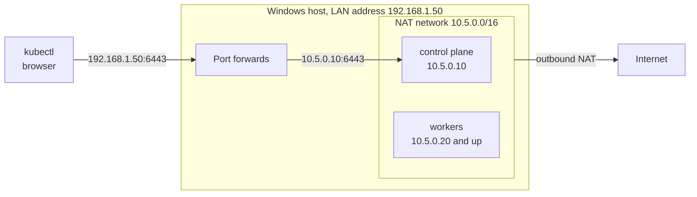
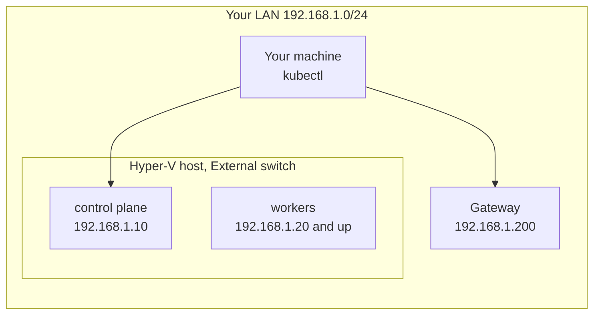
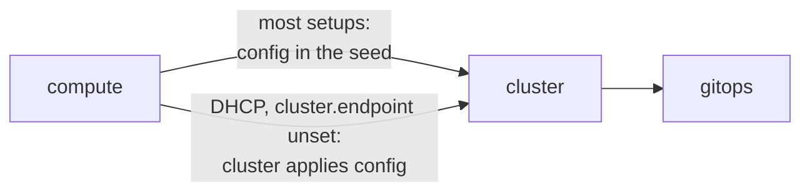

[Hyper-V](https://learn.microsoft.com/en-us/virtualization/hyper-v-on-windows/) is the hypervisor built into Windows Pro, Enterprise, and Server. Windsor applies the [`core` blueprint](../blueprints/overview.md) to a Hyper-V host. Terraform creates Talos Linux VMs and bootstraps Kubernetes, and Flux installs the blueprint's services.

Windsor supports a single Hyper-V host, which makes this platform a fit for prototyping and single-host edge deployments.

This page walks through a setup that routes traffic through host ports. For other networking options, read [Choose a network setup](#choose-a-network-setup).

## Before you start

You need:

- A Hyper-V host running Windows 10 or 11 Pro or Enterprise, or Windows Server, with the [Hyper-V role enabled](https://learn.microsoft.com/en-us/windows-server/virtualization/hyper-v/get-started/install-hyper-v).
- Local Administrator rights on that host. Creating switches, NAT rules, and port forwards requires them.
- Free resources for the default single-node cluster: 4 vCPUs, 12 GiB of memory, and a 30 GB disk. Set `cluster.controlplanes.cpu`, `cluster.controlplanes.memory`, and `cluster.controlplanes.root_disk_size` to change them.
- `terraform` on the machine that runs Windsor, and `kubectl` to inspect the cluster. [`windsor check`](https://www.windsorcli.dev/reference/cli/commands/check) verifies your tools.
- Internet access for that machine and for the VMs. Terraform downloads the Talos ISO from `factory.talos.dev` to the machine that runs Windsor, then copies it to the host. The VMs pull container images from public registries.
- A git repository for the project. [`windsor init`](https://www.windsorcli.dev/reference/cli/commands/init) refuses to scaffold outside one.

The quick start runs Windsor on the Hyper-V host. To run it from another machine, see [Run Windsor from another machine](#run-windsor-from-another-machine).

## What gets created

The quick start uses a NAT switch. The blueprint creates a private network on the host, puts the VMs on it, and forwards the cluster's ports from the host's LAN address.



The control plane gets `10.5.0.10` and workers start at `10.5.0.20`. The VMs reach the internet through the host.

Each VM boots from a Talos Linux ISO downloaded from the [Talos Image Factory](https://factory.talos.dev), with a small generated seed ISO that carries its configuration. On first boot the VM installs Talos to its disk and reboots from it.

## Quick start

### Create the context

```bash
windsor init hyperv-demo --platform hyperv
```

This creates `contexts/hyperv-demo/` and makes it the active context.

### Connect Windsor to the host

The Hyper-V Terraform provider reads its connection settings from `HYPERV_*` environment variables. Put them in `contexts/hyperv-demo/terraform/.env`. Windsor keeps that file out of git and loads it only for Terraform runs. Values can be [secret references](../secrets/overview.md#provider-credentials-in-terraformenv).

When Windsor runs on the Hyper-V host, set only:

```text
HYPERV_BACKEND=local
```

Run Windsor from an elevated PowerShell, which gives the provider Administrator rights.

### Set the values

Add these keys to `contexts/hyperv-demo/values.yaml`. Leave any existing keys as they are:

```yaml
platform: hyperv
gateway:
  service_type: NodePort
cluster:
  endpoint: https://192.168.1.50:6443   # your host's LAN address
```

`gateway.service_type: NodePort` selects the NAT setup. The gateway is published as NodePorts, so the cluster needs no load balancer.

`cluster.endpoint` is the Hyper-V host's own LAN address plus port `6443`. `192.168.1.50` is a placeholder, and should be replaced with your host's IP on the LAN. Run `Get-NetIPAddress -AddressFamily IPv4` on the host to list its addresses.

The VMs sit on a private network that nothing outside the host reaches directly. Clients connect to the host's LAN address instead, and NAT port forwarding on the host passes each port through to a VM. Port `6443` goes to the control plane. The nodes and `kubectl` use the host address as the API URL, and the blueprint adds it to the cluster's certificates. Because the certificates include the address, reserve it on your router or set it statically.

Without this key, composition fails with `required values are not set: cluster.endpoint`.

The NAT subnet is `network.cidr_block`, `10.5.0.0/16` by default. Change it if that overlaps a network you use.

### Bootstrap

```bash
windsor bootstrap hyperv-demo
```

`bootstrap` prepares each node's configuration, downloads the Talos ISO, creates the switch, NAT rule, port forwards, and VMs, bootstraps Kubernetes, installs the Flux blueprint, and waits for every kustomization to report ready. Terraform state for this context lives in the cluster. See [State backend](../provisioning/state-backend.md).

### Check the cluster

```bash
kubectl get nodes               # VMs Ready
kubectl get kustomizations -A   # Flux reconciling
```

`kubectl` uses the context's `KUBECONFIG`. Prefix commands with [`windsor exec --`](https://www.windsorcli.dev/reference/cli/commands/exec), or install the [shell hook](../contexts/environment-injection.md#set-up-the-shell-hook) to export it automatically.

### Reach apps through the gateway

The host forwards the internal gateway's NodePorts by default, `30080` for HTTP and `30443` for HTTPS, so apps answer at `https://<host-address>:30443`. To serve them on `80` and `443` instead, map those host ports to the NodePorts and apply:

```yaml
gateway:
  service_type: NodePort
  publish_ports:
    80: 30080
    443: 30443
```

```bash
windsor apply --wait
```

Each published port also gets a Windows Firewall rule. Choose different host ports on the left if something on the host already uses 80 or 443. HTTP routes match on hostname. A request to the bare host address gets a redirect to HTTPS and then a `404`, so point the names at the host address, for example with a hosts-file entry.

### Day-two changes

```bash
windsor plan                            # summary across all components
windsor apply --wait
```

To add workers, raise `cluster.workers.count` and run `windsor apply --wait` again. Hyper-V clusters don't autoscale.

### Tear down

```bash
windsor destroy --confirm=hyperv-demo
```

`destroy` removes the Flux kustomizations, then the VMs, NAT rule, port forwards, and switch in reverse order. It deletes each VM's disk and seed ISO with the VM. The downloaded Talos ISO stays in `hyperv.base_dir/images`.

## Choose a network setup

Start with NAT and move to another setup when you need LAN access to the VMs.

| Setup                                                  | Use it when                                                                     | Set these                                                                                                                        |
| ------------------------------------------------------ | ------------------------------------------------------------------------------- | -------------------------------------------------------------------------------------------------------------------------------- |
| [NAT](#quick-start) (quick start)                      | You have one host and don't want to change your LAN.                            | `gateway.service_type: NodePort`<br>`cluster.endpoint`                                                                           |
| [External, static](#lan-bridged-with-static-addresses) | Machines on your LAN need to reach the VMs or load balancer addresses directly. | `hyperv.net_adapter`<br>`network.cidr_block`<br>`network.gateway`<br>`network.loadbalancer_driver`<br>`network.loadbalancer_ips` |
| [External, DHCP](#lan-bridged-with-dhcp)               | As above, with addresses from your LAN's DHCP.                                  | `hyperv.net_adapter`<br>`network.dhcp: true`<br>`network.loadbalancer_driver`<br>`network.loadbalancer_ips`                      |
| [Existing switch](#use-an-existing-switch)             | The NIC is already bound to a switch, or you create the switch yourself.        | `hyperv.switch_name` instead of `hyperv.net_adapter`                                                                             |
| [Internal](#internal-switch)                           | You route the VMs' traffic yourself.                                            | Neither `gateway.service_type` nor `hyperv.net_adapter`                                                                          |

### LAN-bridged with static addresses

Set `hyperv.net_adapter` to the `Name` of the host NIC to bridge, as `Get-NetAdapter` lists it, for example `Ethernet` or `Ethernet 2`. The VMs get addresses on your LAN:

```yaml
platform: hyperv
hyperv:
  net_adapter: ["Ethernet"]
network:
  cidr_block: 192.168.1.0/24
  gateway: 192.168.1.1
  loadbalancer_driver: kube-vip
  loadbalancer_ips:
    start: 192.168.1.200
    end: 192.168.1.220
```

Machines on your LAN reach the VMs directly:



Control planes start at `.10` and workers at `.20`. Keep those and the load balancer range out of your router's DHCP pool, or choose the addresses yourself:

```yaml
cluster:
  controlplanes:
    nodes:
      controlplane-1:
        node: 192.168.1.30
        endpoint: 192.168.1.30:50000
```

The keys are `controlplane-<N>` and, under `cluster.workers.nodes`, `worker-<N>`, even for a single node. NAT and DHCP ignore them.

Hyper-V uses the flannel CNI, which has no load balancer, so set `network.loadbalancer_driver` to `kube-vip` or `metallb`. Without one, the gateway's Service stays at `<pending>`. The internal gateway takes the first address in `network.loadbalancer_ips`. With `cluster.cni.driver: cilium`, Cilium provides the addresses instead.

Creating the switch moves the host's own connection onto it, which can drop a remote session. To avoid that, [create the switch yourself](#use-an-existing-switch).

### LAN-bridged with DHCP

Add `network.dhcp: true` to an External setup, and the VMs lease their addresses from your LAN:

```yaml
hyperv:
  net_adapter: ["Ethernet"]
network:
  dhcp: true
  loadbalancer_driver: kube-vip
  loadbalancer_ips:
    start: 192.168.1.200
    end: 192.168.1.220
```

After creating the VMs, Terraform waits five minutes for them to get leases, then uses the first control plane's address as the cluster endpoint. That address goes into every node's configuration, so if the lease changes later, the nodes point at an address that's gone. Reserve the lease on your router, or set `cluster.endpoint` to an address or DNS name that won't change. With Cilium, you must set `cluster.endpoint`.

### Use an existing switch

Set `hyperv.switch_name` to attach the VMs to a switch you created. The blueprint neither creates nor removes it, and NAT ignores the setting.

```yaml
hyperv:
  switch_name: LAN
```

To create an External switch, run this on the host, from its console if you can. The host's connection drops for a few seconds while it moves onto the switch.

```powershell
New-VMSwitch -Name LAN -NetAdapterName "Ethernet" -AllowManagementOS $true
```

### Internal switch

An Internal switch connects only the host and the VMs. With no route out, the nodes can't download Talos or container images unless you provide that routing. Use NAT unless you have it in place.

### Run Windsor from another machine

The provider also reaches the host over SSH or WinRM, so Windsor can run on Linux, macOS, or another Windows machine. Put the settings in `contexts/<context>/terraform/.env`. For SSH:

```text
HYPERV_BACKEND=ssh
HYPERV_HOST=hv01.example.com
HYPERV_USERNAME=Administrator
HYPERV_SSH_PRIVATE_KEY_PATH=~/.ssh/id_ed25519
```

For WinRM over HTTPS:

```text
HYPERV_BACKEND=winrm
HYPERV_HOST=hv01.example.com
HYPERV_USERNAME=Administrator
HYPERV_PASSWORD=${secret("MyVault", "hyperv", "password")}
HYPERV_WINRM_AUTH=ntlm
```

SSH needs OpenSSH Server on the host with PowerShell as its default shell. WinRM needs an HTTPS listener, with NTLM for workgroup hosts or Kerberos in a domain. Either way, the account needs local Administrator rights. The Talos ISO is copied over this connection, so the first `bootstrap` is slower. The [provider documentation](https://registry.terraform.io/providers/windsorcli/hyperv/latest/docs) lists every `HYPERV_*` variable.

### Other settings

| Key                           | Effect                                                               |
| ----------------------------- | -------------------------------------------------------------------- |
| `hyperv.base_dir`             | Host directory for disks and downloaded images. Default `C:/hyperv`. |
| `cluster.cni.driver: cilium`  | Replace flannel with Cilium.                                         |
| `observability.enabled: true` | Install Grafana, Prometheus, and the logging stack.                  |

Each context's `id` suffixes the names of its VMs, disks, and ISOs, so two contexts can share a host. Two NAT contexts can't, because both publish host port `6443`.

## Under the hood

### Boot and configuration

Each VM has a blank disk and two DVD drives: the Talos ISO and a seed ISO labeled `CIDATA`. The ISO comes from the Talos Image Factory with the Hyper-V guest agent built in, which lets the host read the VM's IP address before and after Talos installs. The VM boots the ISO, Talos reads its network settings and machine config from the seed, installs to disk, and reboots from it.

Talos checks the machine config as it boots. If the config is invalid, the node stays on default DHCP networking. The console dashboard shows an empty `IP` and a failed `CONNECTIVITY`, and the log says why.

### Bootstrap order

`windsor bootstrap` runs three Terraform components from the `core` blueprint, in order:

1. `compute` creates the switch, the VMs, their seed ISOs, and any NAT forwards.
2. `cluster` starts Kubernetes and writes the kubeconfig.
3. `gitops` installs Flux.

Each node also needs its machine config. In most setups, `compute` writes it into the seed ISO. With DHCP and no `cluster.endpoint`, the node addresses aren't known until the VMs lease them. In that case `compute` waits five minutes and reads the leases, and `cluster` applies the config.



### The NAT network

`compute` creates an Internal switch and a NAT rule, both named `windsor-<id>`, for `network.cidr_block`. The host takes `.1`, `10.5.0.1` by default, and is the VMs' gateway. Control planes start at `.10` and workers at `.20`.

The host forwards these ports. Each one gets an inbound Windows Firewall rule named `windsor-<id>-<protocol>-<port>`.

| Host port                       | Goes to                                 | When                        |
| ------------------------------- | --------------------------------------- | --------------------------- |
| `6443`                          | The first control plane                 | Always                      |
| `40000` and up                  | Each control plane's Talos API, `50000` | Always                      |
| `40100` and up                  | Each worker's Talos API, `50000`        | Always                      |
| `30080`, `30443`                | The internal gateway                    | The gateway is on (default) |
| `30081`, `30444`                | The external gateway                    | `dns.public_domain` is set  |
| `30292`                         | The Flux webhook                        | `gitops.mode` is `push`     |
| `30053`, TCP and UDP            | Private DNS                             | `dns.private.enabled` is on |
| Keys of `gateway.publish_ports` | The NodePorts they map to               | You set them                |

A host port can forward to only one VM, so each node gets its own port for the Talos API. `controlplane-2` at `10.5.0.11` is `40001`, and `worker-1` at `10.5.0.20` is `40100`. The two ranges sit 100 apart, so adding workers never renumbers the control planes. Both stay below `49152`, where Windows rejects NAT mappings.

### Switch types

| Type     | What it connects                                                      | Created when                         |
| -------- | --------------------------------------------------------------------- | ------------------------------------ |
| Internal | The host and the VMs only                                             | `net_adapter` and NodePort are unset |
| External | The VMs and your LAN, through a host NIC the host keeps sharing       | `hyperv.net_adapter` is set          |
| NAT      | An Internal switch plus a NAT rule for outbound and forwarded traffic | `gateway.service_type: NodePort`     |

### Files and names

Under `hyperv.base_dir`, `C:/hyperv` by default, disks go in `vhds`. Images go in `images`: the Talos ISO, `talos-<version>-metal-amd64-<id>.iso`, and one seed ISO per VM. Names end in the context `id`. `destroy` removes everything the blueprint created except the Talos ISO.

## Troubleshooting

- **Composition fails with `required values are not set: cluster.endpoint`.** The NAT setup needs `cluster.endpoint` to learn the host's address. See [Set the values](#set-the-values).
- **A node never gets its address, and `bootstrap` times out connecting to it.** Open the VM's console in Hyper-V Manager. The Talos dashboard shows `IP` empty and `CONNECTIVITY` failed when the node didn't take its configuration. The log at the bottom says why. A line such as `failed to validate config acquired via platform nocloud` means Talos rejected the configuration it read from the seed. See [Boot and configuration](#boot-and-configuration).
- **DHCP: `bootstrap` fails after the five-minute wait.** In DHCP mode, Terraform reads each VM's leased address from Hyper-V after waiting five minutes. If a VM hasn't reported one by then, the cluster step has no endpoint and no nodes to configure. On the host, `Get-VM <name> | Select-Object -ExpandProperty NetworkAdapters` shows the addresses Hyper-V has, and the VM console shows the one Talos holds. If both are empty, the VM got no lease. Check that your LAN runs DHCP on the bridged NIC's network. If the console has an address and Hyper-V doesn't, the guest agent hasn't reported it yet.
- **`kubectl` times out from another machine.** On NAT, connect to the host's address on the forwarded ports, and check that the Windows Firewall rules exist. An Internal switch is reachable only from the host. Use NAT or an External switch for other machines.
- **`destroy` is refused for an External switch.** Removing an External switch that shares the host's NIC moves the host's address back to the NIC, and a connection that runs over the switch can drop. The Hyper-V provider refuses unless you allow it. Set `hyperv.force_management_os_migration: true` and run `windsor apply` to make the setting take effect, then run `destroy` from the host console or over a connection that doesn't use the switch. With `hyperv.switch_name`, the blueprint never removes the switch, so this doesn't come up.

## Where to next

- [Lifecycle](../provisioning/overview.md): the commands from `init` to `destroy`
- [Destroy](../provisioning/destroy.md): safety behaviors and locking on teardown
- [Terraform](../components/terraform.md): state backends and cross-component outputs
- [vSphere](vsphere.md): the other on-premises VM platform
- [AWS](../cloud/aws.md), [Azure](../cloud/azure.md), [GCP](../cloud/gcp.md), and [Hetzner](../cloud/hetzner.md): the other deployment targets
