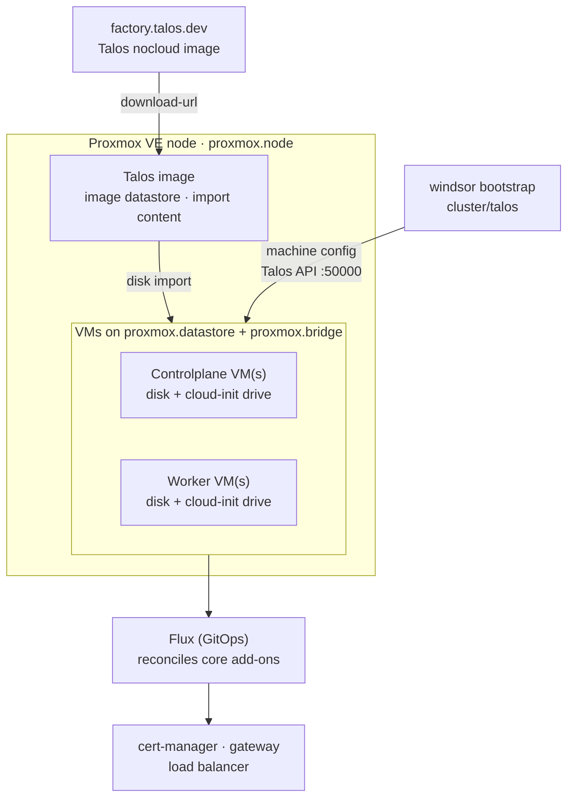

Windsor can place Talos Linux VMs on a [Proxmox VE](https://www.proxmox.com/en/products/proxmox-virtual-environment/overview) node you already run, then have Flux reconcile the `core` blueprint's services on top. The lifecycle is `init` → `bootstrap` → `apply` → `destroy`, the same as a cloud platform. For the concepts behind those verbs, see [Lifecycle](../provisioning/overview.md).

Proxmox suits home labs, edge sites, and on-premises racks that want an open-source hypervisor managed through an API. Windsor drives it with the community [`bpg/proxmox`](https://registry.terraform.io/providers/bpg/proxmox/latest/docs) Terraform provider, using an API token only: no SSH access to the node, no snippets datastore. `cluster.driver` is always `talos`. Windsor places every VM on a single Proxmox node.

## Prerequisites

Windsor creates VMs on a Proxmox node; it doesn't set up the node, its storage, or its network. Before you run anything, the Proxmox host needs:

- **Proxmox VE 8.4 or later**, 9.x recommended. Windsor imports the Talos disk image through the `import` storage content type, which first shipped in 8.4.
- **An image datastore that allows `import` content.** New directory storages enable it by default from 9.1. On an older storage, add it under **Datacenter → Storage → Edit → Content**, or with `pvesm set local --content iso,vztmpl,backup,import`. Windsor uses `local` unless you set `proxmox.image_datastore`.
- **A VM datastore** for disks and cloud-init drives. Windsor uses `local-lvm` unless you set `proxmox.datastore`.
- **A Linux bridge** the VMs attach to, `vmbr0` by default, and the VLAN tag if that network is tagged.
- **A free IP range** on the bridge's subnet for the nodes and the load balancer. Control planes take host addresses 10 and up, workers 20 and up, unless you set addresses per node.
- **Outbound access from the Proxmox node to `factory.talos.dev`.** The node downloads the Talos image itself, through the Proxmox `download-url` API.
- **An API token** with permission to create VMs and download images. See [API token](#api-token).

Beyond the host:

- Terraform (or OpenTofu) and `kubectl` on your `PATH`. Run [`windsor check`](https://www.windsorcli.dev/reference/cli/commands/check) to validate the toolchain.
- A git repository for the project ([`windsor init`](https://www.windsorcli.dev/reference/cli/commands/init) refuses to scaffold outside one).
- A network path from the machine running `windsor` to the node addresses, on the Talos API (port 50000) and the Kubernetes API (port 6443).

### API token

Create a user, a role, and a token on the Proxmox host. The privileges below cover creating VMs, attaching disks and cloud-init drives, downloading images, and reading guest agent addresses. They are a starting point for Proxmox VE 9; review them against your own access policy:

```bash
pveum user add windsor@pve
pveum role add Windsor -privs "VM.Allocate VM.Audit VM.Config.CDROM VM.Config.CPU VM.Config.Cloudinit VM.Config.Disk VM.Config.HWType VM.Config.Memory VM.Config.Network VM.Config.Options VM.PowerMgmt VM.GuestAgent.Audit Datastore.Allocate Datastore.AllocateSpace Datastore.AllocateTemplate Datastore.Audit SDN.Audit SDN.Use Sys.Audit Sys.Modify"
pveum aclmod / -user windsor@pve -role Windsor
pveum user token add windsor@pve windsor --privsep=0
```

The last command prints the token secret once. The provider reads the token as `user@realm!tokenid=secret`, for example `windsor@pve!windsor=<secret>`.

## What gets created

Setting `platform: proxmox` selects the Proxmox path in the `core` blueprint. It deploys VMs onto storage and a bridge you already have:



Windsor asks the node to download the Talos `nocloud` disk image from the Image Factory into the image datastore. The image includes the `qemu-guest-agent` extension, so Proxmox can report each guest's addresses. Each VM gets a copy of that disk and a Proxmox cloud-init drive carrying its address, gateway, and DNS servers. Talos reads the network settings from the cloud-init drive and boots into maintenance mode at that address. The `cluster/talos` component then applies the machine config over the Talos API and bootstraps Kubernetes. Bare metal takes the same path, and the machine config never sits on the Proxmox host.

## 1. Create the context

```bash
windsor init proxmox-lab --platform proxmox
windsor set context proxmox-lab
```

## 2. Configure values

The provider reads its connection settings from the environment, not from `values.yaml`:

| Variable | Value |
|----------|-------|
| `PROXMOX_VE_ENDPOINT` | The API URL, for example `https://pve.lab.local:8006/` |
| `PROXMOX_VE_API_TOKEN` | The token, `windsor@pve!windsor=<secret>` |
| `PROXMOX_VE_INSECURE` | `true` when the API serves a self-signed certificate |

Put them in `contexts/proxmox-lab/terraform/.env`, so Windsor injects them only into Terraform runs, and keep the token in a secrets provider such as [SOPS](../secrets/sops.md) or [1Password](../secrets/1password.md):

```text
PROXMOX_VE_ENDPOINT=https://pve.lab.local:8006/
PROXMOX_VE_API_TOKEN=${secret("MyVault", "proxmox", "token")}
PROXMOX_VE_INSECURE=true
```

See [Secrets](../secrets/overview.md#provider-credentials-in-terraformenv) for how Windsor loads that file.

Then edit `contexts/proxmox-lab/values.yaml`. A minimal cluster on a `/24` LAN:

```yaml
platform: proxmox
proxmox:
  node: pve
network:
  cidr_block: 192.168.10.0/24
  gateway: 192.168.10.1
  loadbalancer_ips:
    start: 192.168.10.200
    end: 192.168.10.220
cluster:
  controlplanes:
    count: 1
  workers:
    count: 2
```

`proxmox.node` is required. It's the node name as Proxmox shows it in the tree, not its hostname or address. With this example, the control plane comes up at `192.168.10.10` and the workers at `192.168.10.20` and `192.168.10.21`. `network.gateway` defaults to the first host address in `network.cidr_block`, and the nameservers default to `1.1.1.1` and `8.8.8.8`.

Set `network.loadbalancer_ips` explicitly. Its default range starts 266 addresses into `network.cidr_block`, which doesn't exist in a `/24` or smaller, so the blueprint fails to compose without it.

As on Hyper-V and vSphere, there's no `cluster.pools`. `cluster.controlplanes.count` and `cluster.workers.count` set node counts directly, sized by `cluster.{controlplanes,workers}.cpu`/`memory`. `topology` is inferred from those counts.

Other common knobs:

| Key | Effect |
|-----|--------|
| `proxmox.datastore` | Datastore for VM disks and cloud-init drives. Default `local-lvm`. |
| `proxmox.image_datastore` | Datastore the Talos image downloads to. It must allow `import` content. Default `local`. |
| `proxmox.bridge` | Linux bridge for the VM NIC. Default `vmbr0`. |
| `proxmox.vlan_id` | VLAN tag for the VM NIC. Unset leaves the NIC untagged. |
| `proxmox.arch` | `amd64` (default) or `arm64`. `arm64` selects the arm64 image, UEFI firmware, and the `host` CPU type. |
| `proxmox.cpu_type` | QEMU CPU type. Default `x86-64-v2-AES` on amd64, which Talos needs and which keeps live migration possible; `host` is the faster alternative. |
| `proxmox.bios` | `seabios` (default) or `ovmf` for UEFI. |
| `proxmox.image_content_type` | `import` (default). `iso` is for Proxmox VE older than 8.4, and the provider then needs SSH access to the node to import the disk. |
| `cluster.controlplanes.nodes`, `cluster.workers.nodes` | Fixed addresses per node, keyed `controlplane-<n>` and `worker-<n>`, with the address in `node`. |
| `observability.enabled: true` | Grafana, Prometheus, and the logging stack. |

### DHCP instead of static addresses

Set `network.dhcp: true` to let your DHCP server assign node addresses. The cloud-init drive then requests DHCP, and Windsor waits for the guest agent to report each VM's address before it applies the machine config. Under the default `cilium` CNI, DHCP also needs a fixed `cluster.endpoint`, because Cilium needs the Kubernetes API address before any lease exists. Reserve the control plane's address on your DHCP server and point `cluster.endpoint` at it:

```yaml
network:
  dhcp: true
cluster:
  endpoint: https://192.168.10.10:6443
```

### Load balancing

Proxmox VMs get real routed addresses on your network, so an in-cluster load balancer works the way it does on bare metal. `kube-vip` in ARP mode needs no switch configuration, only the reserved range in `network.loadbalancer_ips` on the nodes' subnet:

```yaml
cluster:
  cni:
    driver: flannel
network:
  loadbalancer_driver: kube-vip
  loadbalancer_ips:
    start: 192.168.10.200
    end: 192.168.10.220
```

The load balancer isn't installed under the default `cilium` CNI, so the example also sets `cluster.cni.driver` to `flannel`. MetalLB (also ARP mode) is supported as an alternative.

## 3. Bootstrap

```bash
windsor bootstrap proxmox-lab
```

`bootstrap` has the node download the Talos image, creates the VMs from it, and starts them. Once each VM is up in maintenance mode at its address, `bootstrap` applies the machine config, bootstraps Kubernetes, then installs the Flux blueprint and waits for every kustomization to report ready. The first run waits on the image download, about 250 MB per architecture.

## 4. Verify

```bash
kubectl get nodes                       # VMs Ready
kubectl get kustomizations -A           # Flux reconciling
windsor show blueprint                  # the fully composed blueprint
```

`kubectl` uses the context's `KUBECONFIG`; prefix with [`windsor exec --`](https://www.windsorcli.dev/reference/cli/commands/exec) or install the [shell hook](../contexts/environment-injection.md) so it's exported automatically.

In the Proxmox web UI, the VMs carry the tags `windsor`, the context name, and their role.

## 5. Day-two changes

```bash
windsor plan                            # summary across all components
windsor apply --wait
```

Raising `cluster.workers.count` adds VMs on the next `apply`. There's no autoscaling group: each VM is a fixed Terraform resource sized by `cluster.workers.cpu`/`memory`.

A new Talos version downloads a new image, but existing VMs keep the disk they were created from. The machine config sets each node's install image to the Talos `nocloud-installer` image with the guest agent extension, so an in-place upgrade keeps both. See [Talos nodes](../provisioning/upgrade.md#talos-nodes) for how nodes upgrade.

## 6. Tear down

```bash
windsor destroy --confirm=proxmox-lab
```

`destroy` removes the Flux kustomizations, then stops and deletes the VMs with their disks and cloud-init drives, then deletes the downloaded Talos image. Windsor never touches the node's storage configuration, its bridges, or the API token.

## Troubleshooting

- **Image download fails with a content type error.** The image datastore doesn't allow `import` content. Enable it on that storage, or point `proxmox.image_datastore` at one that does. On Proxmox VE older than 8.4, `import` doesn't exist; set `proxmox.image_content_type: iso` and give the provider SSH access to the node.
- **`401` or `403` from the Proxmox API.** Check `PROXMOX_VE_API_TOKEN` is the full `user@realm!tokenid=secret` string, and that the role is granted on `/`. A token created with privilege separation has none of the user's privileges until you grant them to the token itself; `--privsep=0` avoids that.
- **Image download times out or fails outbound.** The Proxmox node itself needs the network path to `factory.talos.dev`, not the machine running `windsor`.
- **`bootstrap` stalls applying the machine config.** The VM isn't reachable on port 50000 at its address. Open the VM's console in Proxmox: Talos prints the address it took from the cloud-init drive. A wrong bridge, a missing `proxmox.vlan_id`, or a gateway outside `network.cidr_block` leaves the node unreachable.
- **Composition fails with `host number 266 is out of range`.** `network.loadbalancer_ips` is unset on a `/24` or smaller network. Set a free range on the nodes' subnet.

## Where to next

- [Lifecycle](../provisioning/overview.md): the commands from `init` to `destroy`
- [Destroy](../provisioning/destroy.md): safety behaviors and locking on teardown
- [Terraform](../components/terraform.md): state backends and cross-component outputs
- [Secrets](../secrets/overview.md): keeping `PROXMOX_VE_API_TOKEN` out of the repository
- [Hyper-V](hyperv.md) and [vSphere](vsphere.md): the other on-premises VM platforms
- [AWS](../cloud/aws.md), [Azure](../cloud/azure.md), [GCP](../cloud/gcp.md), and [Hetzner](../cloud/hetzner.md): the other deployment targets
