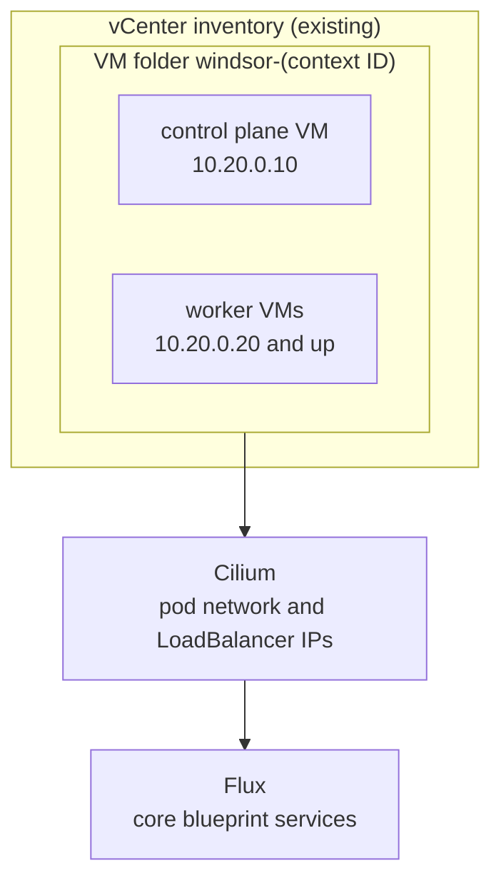

Windsor runs the [`core` blueprint](../blueprints/overview.md) on [VMware vSphere](https://www.vmware.com/products/cloud-infrastructure/vsphere). Terraform creates Talos Linux VMs through vCenter, and Flux installs the blueprint's services once Kubernetes is up. The blueprint replaces Talos's built-in flannel with Cilium, which networks the pods and assigns LoadBalancer IPs.

## Prerequisites

Windsor doesn't create vCenter inventory. Set these up first:

- A datacenter.
- A compute cluster with at least one ESXi host. Windsor can't use a standalone host.
- A datastore and a port group that host can reach.

The ESXi host and the VMs must reach the internet. The host downloads the Talos OVA from `factory.talos.dev`, and the VMs pull container images from public registries. Air-gapped sites aren't yet supported.

On the machine that runs Windsor:

- vCenter credentials that can create VMs and folders.
- Terraform (or OpenTofu) and `kubectl`. [`windsor check`](https://www.windsorcli.dev/reference/cli/commands/check) verifies these tools are available and meet the minimum version requirement.
- A git repository for the project. [`windsor init`](https://www.windsorcli.dev/reference/cli/commands/init) refuses to scaffold outside one.

To check inventory names before you write `values.yaml`, [`govc`](https://github.com/vmware/govmomi/tree/main/govc) works with the same vCenter credentials set as `GOVC_URL`, `GOVC_USERNAME`, `GOVC_PASSWORD`, and `GOVC_INSECURE`.

## What gets created



Terraform deploys each VM from a Talos OVA and writes its machine config into vSphere guestinfo, which Talos reads on first boot. The OVA includes the VMware Tools agent, so vCenter shows each VM's IP address. Terraform also installs Cilium, because Flux's pods can't start without a pod network. After that, Flux manages Cilium along with the rest of the blueprint.

## 1. Create the context

`windsor init` reads the vSphere inventory keys when it sets up the blueprint, so write them first. Create `contexts/vsphere-prod/values.yaml`:

```yaml
platform: vsphere
vsphere:
  server: vcenter.plant.local
  user: administrator@vsphere.local
  datacenter: dc-prod
  cluster: cluster-01
  datastore: datastore-01
  network: "VM Network"
network:
  cidr_block: 10.20.0.0/24
  loadbalancer_ips:
    start: 10.20.0.200
    end: 10.20.0.220
cluster:
  controlplanes:
    count: 1
  workers:
    count: 2
```

Then create the context:

```bash
windsor init vsphere-prod --platform vsphere
```

`init` adds the `core` blueprint, generates a context ID in `values.yaml`, and makes `vsphere-prod` the active context.

## 2. Configure values

`datacenter`, `cluster`, `datastore`, and `network` are required and must match the names in vCenter exactly. If vCenter uses a self-signed certificate, add `vsphere.insecure: true`.

The password doesn't go in `values.yaml`. Put it in `contexts/vsphere-prod/terraform/.env`, which Windsor keeps out of git and loads for Terraform runs:

```text
VSPHERE_PASSWORD=${secret("MyVault", "vsphere", "password")}
```

Use plain text or a [secret reference](../secrets/overview.md#provider-credentials-in-terraformenv). Windsor exports the other connection keys as `VSPHERE_SERVER`, `VSPHERE_USER`, and `VSPHERE_ALLOW_UNVERIFIED_SSL`.

### Node addresses

Nodes get static addresses from `network.cidr_block`. Control planes start at the 10th host (`10.20.0.10`) and workers at the 20th. The default route is the first host, and DNS goes to `1.1.1.1` and `8.8.8.8`. Set `network.gateway` or `network.nameservers` if your LAN differs.

Every context uses the same offsets. A second context on the same subnet must list its own node addresses and its own load balancer range:

```yaml
network:
  loadbalancer_ips:
    start: 10.20.0.230
    end: 10.20.0.240
cluster:
  controlplanes:
    count: 1
    nodes:
      controlplane-1:
        node: 10.20.0.110
  workers:
    count: 2
    nodes:
      worker-1:
        node: 10.20.0.120
      worker-2:
        node: 10.20.0.121
```

Key each entry by its position in the pool (`controlplane-1`, `worker-2`), even when the pool has one node. Windsor doesn't check for addresses that overlap with another context.

Each node defaults to 4 vCPUs and 8 GiB of memory, with a 30 GB root disk on control planes and 50 GB on workers. To change them, set `cpu`, `memory`, and `root_disk_size` under `cluster.controlplanes` or `cluster.workers`.

### Load balancing

Cilium hands out LoadBalancer addresses from `network.loadbalancer_ips`. For each address, one node answers ARP with its own MAC address. vSphere's default port group security policy allows that, so anything that can reach the node subnet reaches the address without switch changes. The internal gateway gets the first address.

Choose free addresses on the nodes' subnet, outside your DHCP scope and above the node addresses. Windsor's default range doesn't fit in a `/24` or smaller subnet, so set the range explicitly.

The answering node receives all of that address's inbound traffic, and another node takes the address over if it fails. NSX SpoofGuard and dynamic ARP inspection on physical switches can drop these ARP replies. If your network uses either, allow the pool addresses on the node ports.

### Storage

Each VM gets one thin-provisioned disk. It holds Talos, container images, etcd on control planes, and persistent volumes, which OpenEBS creates as local volumes under `/var/mnt/local`. A volume stays on the node that created it, and destroying or removing that VM deletes the volume.

Size the disks before the first `bootstrap`. Windsor sets `root_disk_size` only when it creates a VM. Put control planes on a low-latency datastore, such as SSD or vSAN flash, because etcd stalls when disk writes are slow.

Longhorn and Mayastor require a second disk on each node, which these VMs don't have, so `cluster.storage.driver` stays at `openebs` on vSphere.

### Other settings

| Key | Effect |
|-----|--------|
| `vsphere.folder` | Existing VM folder, relative to the datacenter. If unset, Windsor creates `windsor-<id>`, named for the context ID. |
| `vsphere.resource_pool` | Resource pool path, relative to the compute cluster. Defaults to the cluster's root pool. |
| `vsphere.host_system` | ESXi host for the VMs. Required when the datacenter has more than one host. |
| `network.dhcp: true` | Nodes take DHCP addresses, which VMware Tools reports back. For Cilium, also set `cluster.endpoint` to a fixed control-plane address. |
| `observability.enabled: true` | Installs Grafana, Prometheus, and the logging stack. |

## 3. Bootstrap

```bash
windsor bootstrap vsphere-prod
```

`bootstrap` deploys the VMs, bootstraps Kubernetes, and installs Cilium and Flux. Then it moves Terraform state into the cluster (see [State backend](../provisioning/state-backend.md)) and waits for every kustomization to report ready.

## 4. Verify

```bash
kubectl get nodes                       # VMs Ready
kubectl get kustomizations -A           # Flux reconciling
kubectl get svc -A | grep LoadBalancer  # addresses from the pool
```

`kubectl` uses the context's `KUBECONFIG`. Prefix commands with [`windsor exec --`](https://www.windsorcli.dev/reference/cli/commands/exec), or install the [shell hook](../contexts/environment-injection.md) to export it automatically.

## 5. Day-two changes

```bash
windsor plan
windsor apply --wait
```

To add workers, raise `cluster.workers.count`. Each new VM takes the next address after the last worker.

## 6. Tear down

```bash
windsor destroy --confirm=vsphere-prod
```

`destroy` removes the Flux kustomizations, then the VMs and the folder Windsor created. It doesn't touch the datacenter, cluster, datastore, or port group.

## Troubleshooting

- **`windsor show blueprint` lists no Terraform components.** `init` ran before the required `vsphere.*` keys were set, so the context has no `core` blueprint. Run `windsor init vsphere-prod --platform vsphere --reset`. Your `values.yaml` is kept.
- **The `vsphere_compute_cluster` lookup fails.** `vsphere.cluster` must name a compute cluster, not a standalone host. Add the host to a cluster. A one-host cluster works.
- **The `vsphere_host` lookup fails.** The datacenter has more than one ESXi host. Set `vsphere.host_system` to pick one.
- **The OVA deploy fails or times out.** The ESXi host can't reach `factory.talos.dev`. Segmented plant networks often block it.
- **Pods stay in `ImagePullBackOff`.** The VMs can't reach public container registries. Check the port group's outbound route, and set `network.nameservers` if the LAN blocks `1.1.1.1` and `8.8.8.8`.
- **A LoadBalancer Service stays `<pending>`, or its address doesn't answer.** Check that `network.loadbalancer_ips` sits inside `network.cidr_block`. If it does, look for NSX SpoofGuard or ARP inspection dropping the node's ARP replies.

## Where to next

- [Lifecycle](../provisioning/overview.md): the commands from `init` to `destroy`
- [Destroy](../provisioning/destroy.md): safety behaviors and locking on teardown
- [Terraform](../components/terraform.md): state backends and cross-component outputs
- [Hyper-V](hyperv.md): the other on-premises VM platform
- [AWS](../cloud/aws.md), [Azure](../cloud/azure.md), [GCP](../cloud/gcp.md), and [Hetzner](../cloud/hetzner.md): the other deployment targets
